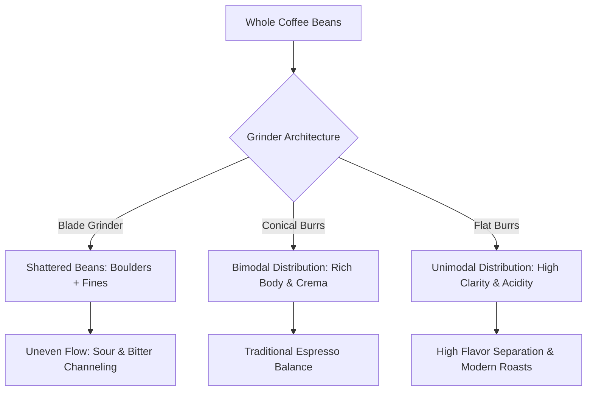

Created: 2026-11-12 17:42
#coffee/theory #note

Repeatable espresso extraction demands total control over the physical architecture of the coffee bed before pressurized water contacts the puck. The barista's toolkit is designed to eliminate density variations, micro-clumping, and void spaces, mitigating the primary failure mode of espresso: **channeling**.

---

## 1. The Grinder: Core Driver of Extraction

The coffee grinder is the single most critical instrument in the espresso workflow. Espresso extraction requires high surface area and tight flow resistance; beans must be ground immediately prior to extraction to prevent the rapid oxidation and dissipation of volatile aromatic compounds.

### Blade vs. Burr Grinders
- **Blade Grinders:** Spinning metal blades randomly shatter coffee beans through blunt impact. This generates an uncontrolled blend of oversized fragments (*boulders*) and microscopic dust (*fines*). Boulders under-extract (sour), while fines over-extract (bitter), producing muddy, astringent shots.
- **Burr Grinders:** Two abrasive rotating surfaces crush beans progressively through geometric shear forces into uniform particle sizes, establishing even hydraulic resistance across the puck.

### Conical vs. Flat Burrs
- **Conical Burrs:** Feature an inner cone burr rotating inside a stationary outer ring. They inherently generate a **bimodal particle size distribution** (two distinct size peaks: uniform grounds alongside a proportion of micro-fines). The fines restrict flow and enhance extraction of oils and melanoidins, generating full body, syrupy mouthfeel, and stable espresso crema.
- **Flat Burrs:** Consist of two parallel ring burrs facing each other. Flat geometries yield a highly **unimodal particle size distribution** with minimal excess fines. This maximizes flavor clarity, transparency of terroir, sweetness, and distinct floral/fruit separation, making them preferred for light and light-medium specialty roasts.

### Grinder Adjustment: Stepless Micro-Mechanisms
Espresso flow rate is exquisitely sensitive to particle size. A micro-adjustment of 5–10 microns can shift shot contact time by 5 to 10 seconds. True espresso grinders require a **stepless** mechanism (smooth threaded adjustment with infinite positions) or ultra-fine stepped collars, enabling microscopic adjustments to accurately lock in flow parameters.

---

## 2. Essential Workflow Accessories

| Tool | Specification | Operational Role |
| :--- | :--- | :--- |
| **Precision Scale** | Accurate to 0.1g, integrated timer | Measures dry dose input and liquid yield output. Volumetric extraction is unreliable due to variable crema volume; mass measurement is mandatory for repeatability. |
| **Metal Tamper** | Heavy stainless steel / brass, precision basket fit (e.g., 58.5mm for 58mm baskets) | Compresses loose grounds into a cohesive, level puck of uniform density. Flimsy plastic stock tampers leave loose perimeters that invite edge channeling. |
| **Knock Box** | Reinforced container with rubberized crossbar | Allows clean, rapid eviction of spent hot pucks without denting or deforming portafilter ears. |
| **Milk Steaming Pitcher** | Food-grade stainless steel with pointed pour spout | Facilitates fluid vortex dynamics for microfoam texturing and provides precise flow control for milk integration and latte art. |

---

## 3. Advanced Puck Preparation & Diagnostic Tools

### Weiss Distribution Technique (WDT)
Grinding creates electrostatic friction that causes fine grounds to aggregate into micro-clumps. Compressing these clumps creates internal density differentials: water flows around dense clumps and erodes low-density channels through the bed.
- **Mechanism:** A tool utilizing 4–10 flexible acupuncture-grade needles (**0.25mm – 0.4mm diameter**) is swept through the coffee bed in deep circular motions from basket bottom to top.
- **Outcome:** De-clumps agglomerates, distributes fines evenly, and homogenizes bed density, reducing channel formation.

### Surface Distribution / Leveling Tools
A circular tool featuring angled metal fins that rests on the portafilter rim. When spun, it levels the upper 2–3 millimeters of loose grounds prior to tamping. This ensures the tamper enters the basket strictly perpendicular to the vertical axis, preventing an angled puck surface.

### Puck Screen
A thin (0.8–1.7mm) sintered multi-layer stainless steel mesh disc (typically 100–150 microns) placed directly on top of the tamped puck.
- **Flow Dispersion:** Softens and evenly diffuses the initial high-pressure water stream delivered by the group head shower screen, eliminating puck face cratering.
- **Hygiene & Maintenance:** Eliminates coffee ground back-flush into the group head shower screen and solenoid valve upon brew cycle release.

### Bottomless (Naked) Portafilter
A portafilter with the bottom casing and dual spout channels completely removed, leaving the underside of the filter basket fully exposed.
- **Diagnostic Role:** Provides direct visual inspection of fluid dynamics. A correctly prepared puck exhibits an even, symmetrical bead formation that coalesces into a single central golden stream.
- **Channeling Detection:** High-pressure water spurts, spray jets, rapid local blonding, or donut extractions (perimeter flow) reveal flaws in puck prep and density uniformity.

---

## References
1. [Scott Rao - Espresso Extraction: Measurement and Management](https://www.scottrao.com/products/espresso-extraction-measurement-and-management)
2. [James Hoffmann - How to Distribute Espresso Grounds (YouTube)](https://www.youtube.com/watch?v=132kZ-pS3x0)
3. [Barista Hustle - The Physics of Espresso Puck Preparation](https://www.baristahustle.com/blog/espresso-puck-preparation/)
4. [John Weiss - The Weiss Distribution Technique (Home-Barista)](https://www.home-barista.com/)

---

## See Also
- [[Coffee Dashboard]]
- [[Espresso Extraction & Dialing In]]
- [[Water Chemistry for Coffee]]
- [[Roasting & Roast Levels]]

#### Tags
#coffee #espresso #puck_prep #grinder #wdt #barista_tools #channeling
