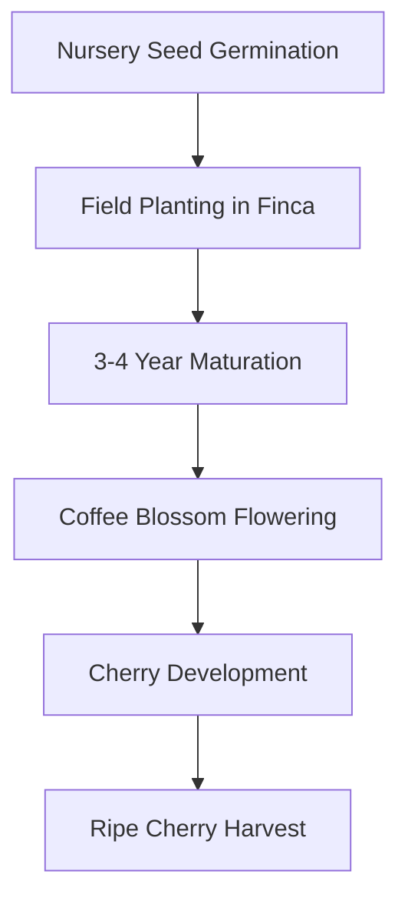
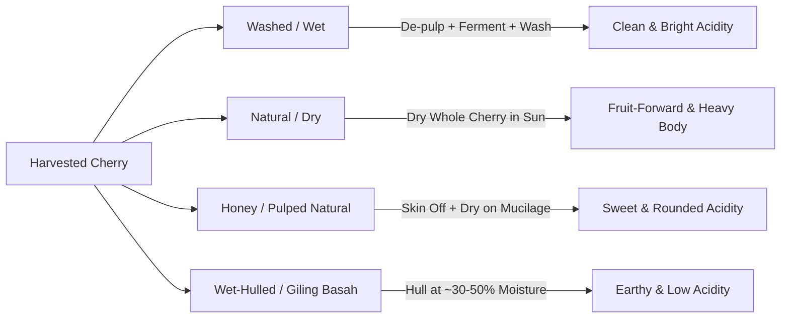

Created: 2026-11-12 17:42
#coffee/theory #note

The journey of coffee begins in the agricultural realm, where botanical genetics, microclimate, elevation, and post-harvest processing establish the chemical ceiling for cup quality. Green coffee represents the preserved potential of these farming and milling decisions, which roasters and baristas can subsequently extract but never amplify.

---

## 1. Cultivation in the Bean Belt

Coffee grows predominantly in the **Bean Belt**, an equatorial band bounded by the Tropics of Cancer and Capricorn. This zone provides the necessary environmental conditions: rich volcanic soil, consistent equatorial photoperiods, moderate-to-heavy rainfall, and temperate microclimates moderated by altitude.

### Cultivation Lifecycle
- **Nursery Germination:** Coffee seeds are germinated in shaded nursery beds, shielding delicate seedlings from direct sunlight and wind for several months until sturdy root systems establish in nursery bags.
- **Field Transplantation:** Seedlings are planted in permanent farm plots (*fincas*), typically timed with wet seasons to allow root stabilization.
- **Maturation & Flowering:** A coffee tree requires 3–4 years to reach fruit-bearing maturity. The cycle initiates with brief, fragrant white blossoms (**coffee blossoms**) following seasonal rains.
- **Fruit Maturation:** Blossoms yield green fruit nodes that slowly ripen over 7–9 months into cherries, transitioning to deep crimson, orange, or yellow depending on varietal.

---

## 2. Harvesting Methodologies

Harvesting timing directly governs bean sugar density and chemical complexity. Unripe cherries introduce astringent and vegetative compounds, while overripe cherries risk uncontrolled fermentation.

- **Selective Picking:** Pickers harvest only fully ripe cherries by hand in iterative cycles (every 8–10 days across the harvest season). This labor-intensive method minimizes defective beans and forms the standard for high-grade specialty Arabica.
- **Strip Picking:** All cherries on a branch—unripe, ripe, and overripe—are stripped off simultaneously, either manually or via mechanized harvesting tractors (common on flat terrain such as Brazilian *cerrado* estates). This requires intensive optical or density sorting post-harvest to separate defects.

---

## 3. Post-Harvest Processing Methods

Processing separates the coffee bean (seed) from the outer fruit layers: outer skin (*exocarp*), fleshy pulp (*mesocarp*), sticky pectin layer (*mucilage*), protective parchment hull (*endocarp*), and thin silverskin (*testa*). The method chosen fundamentally dictates the chemical profile and acidity of the green bean.

### Washed (Wet) Process
The outer skin and fruit pulp are mechanically scrubbed away within hours of harvest. The beans, coated in sticky pectin mucilage, rest in underwater fermentation tanks for 12–72 hours. Microbial and enzymatic activity breaks down the pectin, after which the seeds are thoroughly washed with clean water and dried on patios or raised beds.
- **Cup Profile:** High clarity, vibrant and crisp acidity, transparent terroir representation, clean finish.
- **Key Regions:** Central America, Colombia, Kenya, Ethiopia (Yirgacheffe).

### Natural (Dry) Process
The oldest processing method, originating in Ethiopia. Intact coffee cherries are spread in thin layers across raised drying beds or concrete patios and dried under the sun for 2–4 weeks while being turned regularly to prevent mold. The fruit ferments and dehydrates around the seed, allowing sugars and esters from the fruit pulp to infuse the bean.
- **Cup Profile:** Heavy and syrupy body, prominent berry and tropical fruit esters (blueberry, strawberry), winey acidity, lingering sweet finish.
- **Key Regions:** Ethiopia (Sidamo, Harrar), Brazil, Yemen.

### Honey (Pulped Natural) Process
A hybrid method pioneered in Costa Rica. The skin is mechanically removed, but a calibrated percentage of sticky mucilage is retained on the parchment during drying.
- **Yellow Honey:** ~25% mucilage retained; dried quickly under intense sun; profile leans clean with delicate sweetness.
- **Red Honey:** ~50% mucilage retained; dried under partial shade; balanced sweetness and rounded acidity.
- **Black Honey:** Up to 100% mucilage retained; dried slowly under full shade; maximizes body, dark fruit, and molasses sweetness.

### Wet-Hulling (*Giling Basah*)
A traditional Indonesian regional variant. Farmers de-pulp cherries and dry beans only partially (to ~30–50% moisture) before removing the parchment hull (*hulling*). The naked, semi-moist beans are then dried directly to their export moisture content (~11–12%).
- **Cup Profile:** Distinct low acidity, heavy syrupy mouthfeel, pronounced cedar, dark chocolate, tobacco, and earthy/spice notes.
- **Key Region:** Sumatra, Sulawesi.

---

## 4. Milling, Sorting, and Green Grading

Prior to export, dry parchment coffee undergoes dry milling:
1. **Hulling:** Mechanical removal of dried parchment (*endocarp*) in washed/honey coffees, or dried fruit husks in natural coffees.
2. **Polishing:** Optional friction removal of residual silverskin.
3. **Grading & Sorting:**
   - **Screen Sizing:** Vibration screens separate beans by standardized hole diameters (e.g., Screen 17/18 for Supremo, Screen 15/16 for Excelso in Colombia; AA, AB in Kenya).
   - **Density Separation:** Gravity tables separate lighter, underdeveloped beans from dense, high-altitude beans.
   - **Optical Color Sorting:** Trichromatic optical sensors eject discolored, fermented, or insect-damaged beans.
4. **Export Packaging:** Green coffee is packed at 10–12% moisture into 60kg or 69kg burlap bags lined with airtight hermetic liners (GrainPro) to prevent ambient moisture absorption and oxidation.

---

## 5. Botanical Species: Arabica vs. Robusta

Commercial coffee is overwhelmingly dominated by two botanical species within the *Coffea* genus: *Coffea arabica* and *Coffea canephora* (Robusta).

| Parameter | *Coffea arabica* (Arabica) | *Coffea canephora* (Robusta) |
| :--- | :--- | :--- |
| **Ploidy & Genetics** | Tetraploid (44 chromosomes), self-pollinating | Diploid (22 chromosomes), cross-pollinating |
| **Flavor Profile** | Complex, floral, fruity, sweet, balanced acidity | Bold, harsh, woody, rubbery, bitter, nutty |
| **Acidity** | High, bright, multi-faceted (citric, malic, phosphoric) | Low to flat |
| **Body & Texture** | Light, tea-like, silky to medium | Viscous, heavy, oily, thick |
| **Caffeine Content** | ~1.2% – 1.5% by dry weight | ~2.2% – 2.7% by dry weight (natural insecticide) |
| **Lipid & Sugar Content** | 15–17% lipids, 6–9% sucrose | 10–11% lipids, 3–5% sucrose |
| **Bean Morphology** | Elongated, oval, curved center crease | Small, rounded, straight center crease |
| **Optimal Altitude** | 900 – 2,200m (3,000 – 7,200 ft) | Sea level – 800m (0 – 2,600 ft) |
| **Optimal Temperature** | 15°C – 24°C (sensitive to frost and heat) | 24°C – 30°C (heat tolerant) |
| **Disease Resistance** | High susceptibility to Coffee Leaf Rust (*Hemileia vastatrix*) | High natural resistance to pests and fungal blights |
| **Economic Role** | Specialty coffee standard, single origins | Commercial instant coffee, traditional Italian crema blends |

---

## References
1. [Specialty Coffee Association (SCA) - Standards](https://sca.coffee/research/coffee-standards)
2. [World Coffee Research - Coffee Varieties Catalog](https://varieties.worldcoffeeresearch.org/)
3. [James Hoffmann - The World Atlas of Coffee (Book)](https://www.theworldatlasofcoffee.com/)
4. [Scott Rao - The Coffee Roaster's Companion](https://www.scottrao.com/products/the-coffee-roasters-companion)

---

## See Also
- [[Coffee Dashboard]]
- [[Coffee Origins & Terroir]]
- [[Roasting & Roast Levels]]
- [[Flavours & Sensory]]
- [[Science of Flavor Perception]]

#### Tags
#coffee #agronomy #coffee_processing #arabica #robusta #specialty_coffee
