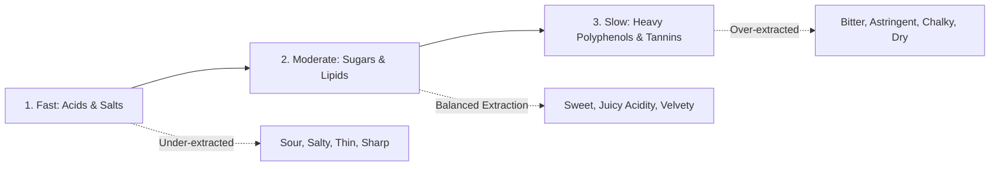
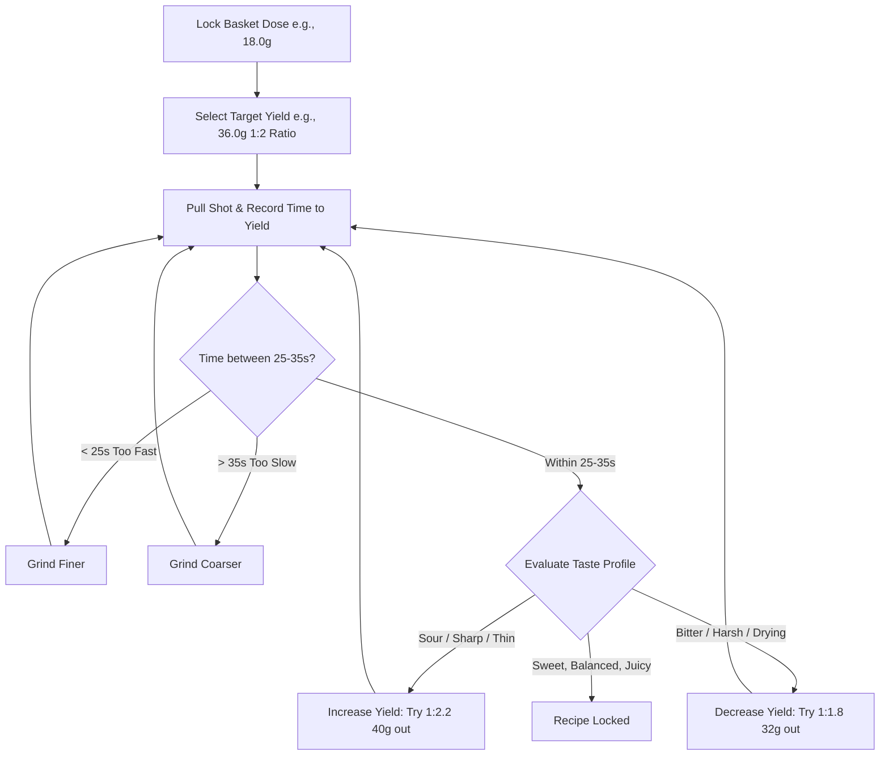

Created: 2026-11-12 17:42
#coffee/theory #note

Espresso extraction is a pressurized dynamic brewing method (typically 6–9 bar) in which heated water (90°C–96°C) dissolves and emulsifies soluble solids, volatile oils, and insoluble micro-particulates from a compacted bed of ground coffee within 25–40 seconds. **Dialing in** is the empirical calibration of dose, grind size, yield, and contact time to maximize extraction of desirable sugars and aromatic acids while suppressing bitter, astringent tannins.

---

## 1. The Core Variables: Dose, Yield, and Time

Espresso recipes are quantified gravimetrically (by weight in grams), rendering volumetric liquid measurements obsolete due to variable crema aeration and gas retention.

$$\text{Brew Ratio} = 1 : \frac{\text{Yield } (Y)}{\text{Dose } (D)}$$

- **Dose ($D$):** The mass of dry ground coffee loaded into the portafilter basket (typically 16.0g – 20.0g for modern precision double baskets). Governed by basket physical volume.
- **Yield ($Y$):** The total mass of liquid espresso beverage extracted into the cup (measured on an integrated scale).
- **Time ($t$):** Elapsed seconds from pump activation (or first drop) until pump shutoff. Acts as a diagnostic benchmark (typically 25–35 seconds).

### Standard Brew Ratios

| Style | Brew Ratio | Example (18g Dose) | Extraction & Sensory Profile |
| :--- | :--- | :--- | :--- |
| **Ristretto (Restricted)** | 1:1 to 1:1.5 | 18g in $\rightarrow$ 18g–27g out | High concentration, syrupy body, heavy viscosity, lower extraction yield; accentuates rich cocoa and sharp acids. |
| **Normale (Standard)** | 1:2 to 1:2.5 | 18g in $\rightarrow$ 36g–45g out | Benchmark specialty espresso ratio; optimal balance between sweetness, origin acidity, clarity, and mouthfeel. |
| **Lungo (Long)** | 1:3 to 1:4 | 18g in $\rightarrow$ 54g–72g out | Higher extraction yield, lighter body, increased clarity; prone to over-extraction and astringency if used with dark roasts. |

---

## 2. Extraction Chemistry & Dynamics

Coffee compounds dissolve into hot water at distinctly different thermodynamic rates:

1. **Polar Acids and Salts (Early Phase):** Citric, malic, and phosphoric acids, alongside chlorogenic acids and mineral salts, possess the highest solubility. They wash out in the initial 0–10 seconds.
2. **Sugars and Aromatic Compounds (Mid Phase):** Simple sucrose, fructose, and volatile lipid compounds dissolve next. They impart sweetness, caramelization notes, aroma complexity, and smooth mouthfeel.
3. **Plant Fibers, Heavy Phenols, and Tannins (Late Phase):** Phenylindanes, chlorogenic acid lactones, and heavy plant fibers require extensive contact time to dissolve. If prolonged, they impart harsh bitterness and drying astringency.

---

## 3. The Systematic Dialing-In Algorithm

Dialing in resolves multi-variable complexity by locking parameters in sequence:

1. **Lock the Dose:** Set an invariant dose based on basket spec (e.g., exactly 18.0g). Do not alter dose during initial dial-in.
2. **Set Target Yield:** Select a baseline 1:2 ratio (36.0g out for an 18.0g dose).
3. **Calibrate Time via Grind Size:** Stop extraction strictly at 36.0g.
   - If time is under 25 seconds: Bed resistance is too low. **Grind finer** to increase surface area and restrict fluid flow.
   - If time exceeds 35 seconds: Bed resistance is too high. **Grind coarser** to relieve hydraulic pressure.
4. **Fine-Tune Balance via Yield (Taste is Primary):**
   - Once contact time sits in the 25–35s window, evaluate sensory balance on the palate.
   - **Sour / Sharp / Salty:** The shot is under-extracted (sugars were not adequately dissolved). Increase yield slightly (e.g., from 36g to 40g) to push extraction higher.
   - **Bitter / Drying / Astringent:** The shot is over-extracted (excess tannins dissolved). Decrease yield slightly (e.g., from 36g to 32g) to cut the extraction short.

---

## 4. Extraction Faults & Troubleshooting Matrix

| Symptom | Palate Profile | Mechanical Diagnosis | Primary Causes | Corrective Action |
| :--- | :--- | :--- | :--- | :--- |
| **Gushing Shot (<20s)** | Sour, grassy, thin, hollow body | Severe under-extraction | Grind setting excessively coarse; low dose; degraded burrs | Adjust grinder significantly finer; verify basket dose fill. |
| **Choked Shot (>40s / Drips)** | Harsh, intensely bitter, burnt, dry | Severe over-extraction | Grind setting excessively fine; overdosed basket | Adjust grinder coarser; ensure puck has clearance from shower screen. |
| **Sour Shot (In-time)** | Sharp, lemony, acetic, mouth-puckering | Under-extraction of sugars | Water temperature too low; light roast requiring higher ratio | Increase brew ratio (e.g., 1:2 $\rightarrow$ 1:2.3); increase brew boiler temp (e.g., 93°C $\rightarrow$ 95°C). |
| **Bitter / Drying (In-time)** | Astringent, ashy, aspirin-like, drying finish | Over-extraction of tannins | Water temperature too high; dark roast over-extracting | Reduce brew ratio (e.g., 1:2 $\rightarrow$ 1:1.8); reduce water temperature (e.g., 93°C $\rightarrow$ 90°C). |
| **Simultaneously Sour & Bitter** | Disjointed, astringent finish with sour front | **Channeling** (micro-fissures in puck) | Clumpy grounds; unlevel tamp; improper puck prep; high pump pressure | Execute WDT (needle de-clumping); ensure dead-level tamp; use a puck screen. |
| **Crema Dissipates Instantly** | Thin, watery, lacks aromatic persistence | Lack of $CO_2$ or low extraction | Beans are stale (>4–6 weeks post-roast); under-extraction | Use freshly roasted coffee (7–21 days post-roast); verify grind fineness. |

---

## References
1. [Scott Rao - The 2:1 Espresso Ratio](https://www.scottrao.com/blog/2017/12/17/the-21-ratio)
2. [Jim Schulman - The Ins and Outs of Espresso Extraction (Home-Barista)](https://www.home-barista.com/)
3. [James Hoffmann - Understanding Espresso (YouTube Series)](https://www.youtube.com/playlist?list=PLxz0Fj353r7Xz72k0iQ4pA0o_1tQ4281x)
4. [Barista Hustle - The Espresso Compass](https://www.baristahustle.com/blog/the-espresso-compass/)

---

## See Also
- [[Coffee Dashboard]]
- [[Barista Toolkit & Puck Preparation]]
- [[Water Chemistry for Coffee]]
- [[Flavours & Sensory]]
- [[Roasting & Roast Levels]]

#### Tags
#coffee #espresso #extraction #dialing_in #brewing #brew_ratio #barista
