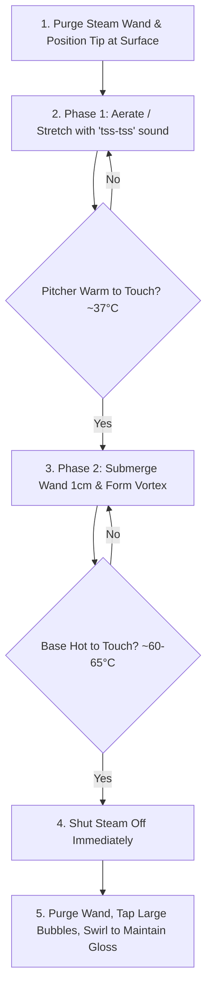

Created: 2026-11-12 17:42
#coffee/theory #note

Milk steaming is the thermo-mechanical process of introducing pressurized steam into cold milk to create a homogeneous, liquid emulsion of milk fats, denatured proteins, and microscopic air bubbles known as **microfoam**. The distinction between classic café milk beverages is defined not by rigid volume alone, but by the thickness, air volume, and structural integration of this foam with the espresso base.

---

## 1. Physics and Chemistry of Milk Steaming

Milk is an emulsion of butterfat globules suspended in a water solution containing proteins (casein micelles and whey proteins), lactose sugars, and minerals.

- **Protein Denaturation & Foam Stability:** At temperatures between 40°C and 60°C, soluble whey proteins unfold (denature) and orient along the hydrophobic/hydrophilic interfaces of injected air bubbles. This forms a protective elastic membrane that encapsulates micro-bubbles and prevents them from coalescing into coarse foam.
- **Lactose Sweetness:** Perceived sweetness of lactose peaks between 55°C and 65°C (130°F–150°F). Cold milk masks sweetness; overheating destroys it.
- **Thermal Breakdown (Scalding):** Heating milk beyond 68°C–70°C (155°F) completely denatures whey proteins, releasing volatile sulfur compounds that cause cooked, eggy, or burnt off-flavors while causing the foam structure to collapse into watery separation.

---

## 2. Two-Phase Steaming Technique

High-quality microfoam resembles glossy wet paint with zero visible surface bubbles.

### Phase 1: Stretching (Aeration)
- **Positioning:** Start with cold whole milk in a cold stainless steel pitcher (filled to just below the spout indentation). Submerge the steam wand tip a few millimeters below the milk surface, tilted slightly off-center.
- **Steam Activation:** Turn steam fully on. Lower the pitcher slightly until the tip kisses the milk surface, drawing in air with a soft, rhythmic "tss-tss-tss" sound (like tearing paper).
- **Temperature Constraint:** Aeration must be completed before the milk reaches body temperature (~37°C / 100°F). Injecting air into milk warmer than 40°C produces coarse, dry, unstable bubbles.

### Phase 2: Texturing (The Vortex)
- **Vortex Formation:** Elevate the pitcher by ~1 cm to submerge the steam wand tip slightly deeper. Angle the pitcher so the steam jets induce a powerful, rapid circular whirlpool (vortex).
- **Shearing Action:** The centrifugal shearing force of the vortex draws surface air bubbles down into the liquid, breaking macro-bubbles down into sub-millimeter micro-bubbles and distributing heat uniformly.
- **Shutoff:** When the pitcher base becomes uncomfortable to hold for more than one second (60°C–65°C / 140°F–150°F), immediately shut off the steam valve before removing the pitcher.

### Finishing & Pouring
1. **Purge & Wipe:** Instantly wipe the wand with a damp microfiber cloth and purge steam to prevent milk vacuum draw-back into the boiler.
2. **Knock:** Firmly tap the pitcher base once against the counter to pop any residual surface macro-bubbles.
3. **Polish / Swirl:** Continuously swirl the pitcher in circular motions until the milk surface appears uniform and reflective, resembling wet paint. Pour immediately before liquid milk and foam separate.

---

## 3. Beverage Architecture: Flat White vs. Latte vs. Cappuccino

| Beverage | Standard Cup Size | Espresso Base | Milk-to-Coffee Ratio | Microfoam Depth & Structure | Sensory Experience |
| :--- | :--- | :--- | :--- | :--- | :--- |
| **Cappuccino** | 150–180 ml (5–6 oz) | Double Shot (or Single) | ~1:3 (Equal thirds: espresso, steamed milk, dense foam) | Thick, aerated, stable foam cap (**>10–12 mm**). Clear textural contrast between foam head and liquid. | Distinct foam cushion, punchy espresso intensity, rich textural contrast. |
| **Caffè Latte** | 240–350 ml (8–12 oz) | Double Shot | 1:4 to 1:6 | Smooth, thin layer of microfoam (**~4–6 mm**). | Mellow, sweet, milk-dominant, creamy and dessert-like. |
| **Flat White** | 150–180 ml (5–6 oz) | Double Ristretto or Double Espresso | ~1:3 | Ultra-thin, velvety, integrated microfoam (**<3 mm**). No physical separation between foam and liquid. | Strong espresso forwardness, silky, uniform glossy texture from first sip to finish. |

---

## References
1. [James Hoffmann - How to Steam Milk for Latte Art (YouTube)](https://www.youtube.com/watch?v=gTC39IFaAmA)
2. [Scott Rao - The Professional Barista's Handbook](https://www.scottrao.com/products/the-professional-baristas-handbook)
3. [Barista Hustle - Milk Science: Steaming and Microfoam Chemistry](https://www.baristahustle.com/blog/milk-science/)
4. [Specialty Coffee Association (SCA) - Barista Skills Curriculum](https://sca.coffee/education/programs/coffee-skills-program)

---

## See Also
- [[Coffee Dashboard]]
- [[Espresso Extraction & Dialing In]]
- [[Barista Toolkit & Puck Preparation]]
- [[Flavours & Sensory]]

#### Tags
#coffee #milk_steaming #microfoam #latte #cappuccino #flat_white #barista_skills
