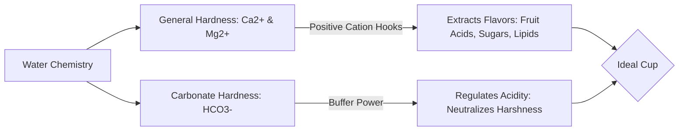

Created: 2026-11-12 17:42
#coffee/theory #note

Water comprises over 98% of a filter brew and roughly 88–92% of an espresso shot. Far from an inert diluent, water functions as an active chemical solvent whose dissolved mineral ions selectively bind to, extract, and buffer the organic acids, sugars, and aromatic compounds locked within the coffee cell matrix.

---

## 1. Water as an Active Solvent

Extraction is driven by chemical affinity. Water is a polar molecule, but pure deionized water ($\text{H}_2\text{O}$ at 0 TDS) is an ineffective solvent for specialty coffee. Many desirable flavor compounds in coffee are negatively charged or oxygen-rich; they require dissolved mineral cations (**$\text{Ca}^{2+}$ and $\text{Mg}^{2+}$**) to act as chemical hooks that pull them out of the grounds into solution.

- **Pure / Distilled Water (0 TDS):** Results in a flat, thin, aggressively sour, and under-extracted cup lacking sweetness and body. Additionally, mineral-free water can leach copper and brass from espresso boilers.
- **Excessively Hard Water (>300 ppm):** Saturates extraction early, extracting heavy, chalky, and bitter compounds while precipitating destructive calcium carbonate limescale ($\text{CaCO}_3$) inside machine boilers and thermoblocks.

---

## 2. Core Chemical Parameters & SCA Standards

### General Hardness ($\text{GH}$): Calcium and Magnesium
General Hardness quantifies the concentration of multivalent metal cations, primarily calcium ($\text{Ca}^{2+}$) and magnesium ($\text{Mg}^{2+}$).
- **Magnesium ($\text{Mg}^{2+}$):** High charge density with a smaller ionic radius. It bonds aggressively to oxygen-heavy, volatile compounds, pulling bright fruity acids, florals, and sweet sugars into solution.
- **Calcium ($\text{Ca}^{2+}$):** Moderately binds flavor compounds, accentuating heavy body and creamy mouthfeel. However, at temperatures above 60°C, calcium readily bonds with bicarbonates to form insoluble scale:
  $$\text{Ca}^{2+} + 2\text{HCO}_3^- \xrightarrow{\Delta} \text{CaCO}_3 \downarrow + \text{CO}_2 \uparrow + \text{H}_2\text{O}$$

### Carbonate Hardness / Alkalinity ($\text{KH}$): Bicarbonate Buffering
Alkalinity measures the capacity of water to neutralize acids, determined primarily by dissolved bicarbonate ions ($\text{HCO}_3^-$).
- **Acid Buffering Mechanism:** Coffee naturally contains citric, malic, and phosphoric acids that provide pleasant brightness. Bicarbonate buffers these acids, converting them to carbon dioxide and water:
  $$\text{H}^+ (\text{organic acids}) + \text{HCO}_3^- \rightleftharpoons \text{H}_2\text{CO}_3 \rightleftharpoons \text{CO}_2 + \text{H}_2\text{O}$$
- **High Alkalinity (>80 ppm):** Over-buffers the beverage, destroying origin acidity and rendering the coffee flat, dull, chalky, and lifeless.
- **Low Alkalinity (<30 ppm):** Fails to buffer harsh organic acids, producing a sharp, vinegar-like, aggressively sour cup.

### SCA Water Quality Specification Standards

| Parameter | SCA Target Standard | Acceptable Range | Sensory / Operational Impact |
| :--- | :--- | :--- | :--- |
| **Total Dissolved Solids (TDS)** | **150 ppm** | 75 – 250 ppm | Total ionic concentration driving extraction efficiency. |
| **Total Hardness ($\text{CaCO}_3$ eq.)** | **68 ppm** (4 grains) | 50 – 175 ppm | Cation strength pulling aromatic acids and sweetness. |
| **Alkalinity ($\text{CaCO}_3$ eq.)** | **40 ppm** | 20 – 80 ppm | Buffer strength balancing cup acidity vs. flat dullness. |
| **pH** | **7.0 (Neutral)** | 6.5 – 8.0 | Neutral baseline allowing clean expression of origin acidity. |
| **Sodium ($\text{Na}^+$)** | **10 ppm** | Near 10 ppm | Enhances sweetness in trace amounts; salty if elevated. |
| **Chlorine / Chloramines** | **0 mg/L** | 0 mg/L strictly | Disinfectants that react with coffee to produce phenolic, medicinal defects. |

---

## 3. Practical Water Solutions for Home Baristas

1. **Carbon Block Filtration (Pitchers / In-Line Filters):** Removes chlorine, volatile organic compounds (VOCs), and foul odors. Ideal if tap water already possesses balanced baseline mineral hardness, but does not substantially adjust $\text{Ca}^{2+}$ or $\text{HCO}_3^-$ levels.
2. **Low-Mineral Bottled Spring Water:** An immediate plug-and-play solution. Brands such as Volvic or specific natural springs with natural TDS of 100–150 ppm and low alkalinity provide balanced extraction without immediate scaling risk.
3. **Remineralized Distilled or Reverse Osmosis (RO) Water:** The gold standard for consistency and espresso machine longevity:
   - **Pre-packaged Mineral Packets (e.g., Third Wave Water, Lotus Coffee Drops):** Engineered packets containing magnesium sulfate, calcium citrate, and sodium bicarbonate added to a gallon of distilled or zero-TDS water.
   - **DIY Mineral Concentrates:** Preparing separate concentrated dropper bottles using food-grade **Epsom salt** ($\text{MgSO}_4\cdot 7\text{H}_2\text{O}$) for hardness and **Baking soda** ($\text{NaHCO}_3$) or **Potassium bicarbonate** ($\text{KHCO}_3$) for alkalinity.

---

## References
1. [Specialty Coffee Association (SCA) - Water Standards Specification](https://sca.coffee/research/coffee-standards)
2. [Christopher H. Hendon et al. - The Role of Dissolved Cations in Coffee Extraction (J. Agric. Food Chem., 2014)](https://pubs.acs.org/doi/10.1021/jf501687c)
3. [Maxwell Colonna-Dashwood & Christopher H. Hendon - Water For Coffee (Book)](https://waterforcoffeebook.com/)
4. [Scott Rao - Water Quality for Espresso Equipment and Flavor](https://www.scottrao.com/blog/2018/1/27/water-quality-for-espresso)

---

## See Also
- [[Coffee Dashboard]]
- [[Espresso Extraction & Dialing In]]
- [[Flavours & Sensory]]
- [[Science of Flavor Perception]]
- [[Barista Toolkit & Puck Preparation]]

#### Tags
#coffee #water_chemistry #extraction #sca #espresso #brewing #tds
