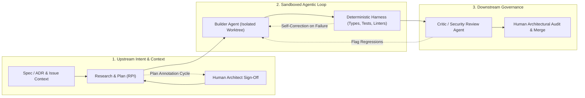
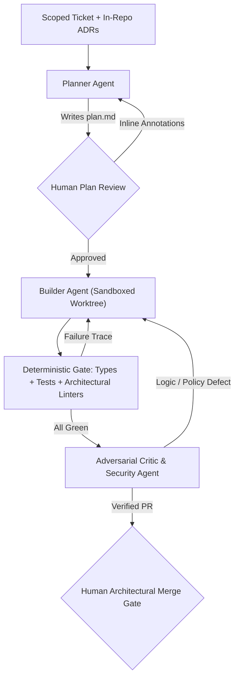

Created: 2026-11-17 09:30
#note

The **Agentic Software Development Life Cycle (Agentic SDLC or A-SDLC)** represents the structural evolution of software engineering from linear, human-typed workflows and localized autocomplete assistants ("Copilots") to repository-scale autonomous orchestration. In an Agentic SDLC, [[AI Agents]] equipped with planning loops, file-system and terminal access, and external context protocols execute multi-step engineering tasks across the entire lifecycle, while human engineers operate primarily as **architects of intent, context engineers, and verification stewards**.

Whereas [[Harness Engineering]] focuses on the immediate scaffolding around a model (`agent = model + harness`) and [[Loop Engineering]] governs the autonomous iteration mechanics across turns, the Agentic SDLC addresses how entire engineering organizations restructure planning, code review, testing, security, and operations when code generation ceases to be the primary bottleneck.

## The Structural Shift: From Sequential to Agentic

Historically, software delivery progressed through distinct paradigms:

1. **Traditional SDLC**: Sequential handoffs across requirements, implementation, testing, and deployment, where both syntax authoring and verification are performed manually.
2. **The Copilot Era (2023–2024)**: Localized, synchronous code completion inside the IDE. The human still drives every line of code and holds the global mental model of the repository.
3. **The Agentic SDLC (2025–2026+)**: Goal-driven, asynchronous execution. Engineers delegate bounded objectives to coding agents that plan changes, traverse dependency graphs, edit multiple files, and run verification harnesses before presenting a verified pull request.

### Phase-by-Phase Transformation

| SDLC Phase | Traditional / Copilot Era | Agentic SDLC Paradigm |
| :--- | :--- | :--- |
| **1. Planning & Requirements** | Product requirements and tickets written for humans relying on implicit tribal knowledge; ambiguities resolved mid-coding. | **Spec-Driven Development ("Planning is the new coding")**: Explicit, machine-readable specifications, acceptance criteria, and Architecture Decision Records (ADRs) validated via the [[Research-Plan-Implement Loop]] and [[Plan Annotation Cycle]] before code generation begins. |
| **2. Architecture & Context** | Documentation scattered across external wikis; architectural boundaries enforced socially during peer review. | **Context Engineering**: Repository-level contracts (`AGENTS.md`, `CLAUDE.md`), tracked in-repo ADRs, [[Code Navigation Graphs]], and live [[MCP Protocol]] connectors expose institutional knowledge directly to agents. |
| **3. Implementation** | Synchronous, single-file or function-level authoring by an individual developer. | **Parallel Orchestration**: Engineers dispatch background agents in isolated git worktrees to execute feature slices, migrations, and refactors concurrently. |
| **4. Testing & QA** | Unit and integration tests frequently authored after implementation; manual QA bottlenecks. | **Closed-Loop Verification Harnesses**: Agents write and execute tests inside ephemeral sandboxes as an intrinsic part of the generation loop, iterating until deterministic checks pass. |
| **5. Code Review** | Peer review blends syntax nitpicks, style checks, and architectural critique. | **Two-Tier Review**: Automated review and security agents perform first-pass behavioral and policy triage; human reviewers focus strictly on system architecture, blast radius, and domain correctness. |
| **6. Operations & Maintenance** | Reactive alert triage, manual log correlation, and periodic tech-debt sprints. | **Continuous Hygiene & Self-Healing**: Background agents ingest telemetry traces, reproduce incidents via failing regression tests, remove dead flags, and execute continuous dependency upgrades. |

## Core Challenges and Failure Modes

Empirical evaluations—including DORA (DevOps Research and Assessment) reports and repository-level benchmarks—demonstrate that accelerating raw code generation without redesigning downstream governance introduces severe systemic friction.

### 1. The Verification Tax and Pull Request Flood
While coding agents increase code generation velocity by an order of magnitude, human cognitive bandwidth for reading and verifying code remains constant. Organizations rapidly encounter a **pull request flood**, shifting the primary bottleneck from authoring to code review. Auditing plausible-looking, machine-generated diffs ("nearly-right code") imposes a higher cognitive load than authoring code from first principles, creating a **verification tax** that can stall delivery pipelines.

### 2. The Velocity Illusion and Architectural Drift
Left unconstrained, coding agents optimize greedily for **local task completion**—satisfying the immediate prompt or passing a narrow unit test—at the expense of **global system integrity**. Common symptoms include:
- Duplicating utility logic rather than reusing canonical internal modules.
- Bypassing architectural boundaries (for example, violating [[Hexagonal Architecture]] layers) to take the shortest path to a green build.
- **The DORA Stability Paradox**: High individual AI adoption often correlates with perceived local speedups alongside degraded delivery stability and elevated change-failure rates when organizational verification gates lag behind generation speed.

### 3. Context Starvation vs. Context Overload
In complex production systems, agent failures rarely stem from raw reasoning deficits; they stem from **missing institutional context** (undocumented runtime invariants, cross-service contracts, or domain edge cases). Conversely, as demonstrated in [[Evaluating AGENTS.md - Are Repository-Level Context Files Helpful for Coding Agents]], naively stuffing bloated, overly prescriptive instructions into static context files can degrade task success rates by distracting the agent with excessive exploration and tool calls. Effective [[Context Constraints for AI Agents]] require concise, high-signal architectural invariants rather than exhaustive prose.

### 4. Security, Supply Chain, and Sandbox Risks
Autonomous tool execution expands the threat surface of the [[Secure SDLC]]:
- **Insecure Code Generation**: Agents may introduce subtle logic vulnerabilities, weaken authentication checks to make failing tests pass, or hallucinate non-existent packages (slopsquatting) that expose the pipeline to [[Supply Chain Security]] attacks.
- **Indirect Prompt Injection**: Agents consuming untrusted external context—such as GitHub issues, third-party documentation, or log payloads via [[MCP Protocol]] servers—can be hijacked into exfiltrating credentials or executing unauthorized commands if not strictly sandboxed.

### 5. The Junior–Senior Skill Paradox
Senior engineers with strong mental models of distributed systems act as high-leverage orchestrators because they can rapidly spot architectural flaws in agent plans. Conversely, junior engineers risk bypassing the foundational debugging struggle required to build deep systems intuition, creating a long-term talent pipeline challenge for engineering organizations.

## Proposed Solutions and Architectural Standards

To resolve these failure modes, industry practitioners have converged on four foundational design pillars.

### 1. "Gate the Merge, Not the Generation" (Deterministic Harnesses)
Rather than throttling how quickly agents write code, organizations harden the deterministic boundaries that code must pass before reaching human reviewers or production branches:
- **Ephemeral Sandboxes**: Executing agent tool calls inside OS-level or container sandboxes with restricted filesystem and network policies.
- **Deterministic Feedback Signals**: Combining strict static type checkers, property-based tests, custom architectural linters (enforcing module dependency graphs), and [[Static Code Analysis]] so agents self-correct objective errors before human handoff. This mirrors the verification philosophy detailed in [[Agentic Vulnerability Discovery - Eliminating False Positives with Deterministic Verification]].

### 2. Multi-Agent Separation of Concerns (Adversarial Verification)
Single-agent self-review suffers from confirmation bias when the same context window both authors and critiques a diff. Production workflows increasingly adopt [[Multi-Agent Systems]] with isolated roles and contexts:
- **Planner Agent**: Investigates the codebase and produces an explicit specification artifact.
- **Builder Agent**: Implements the approved specification inside an isolated git worktree.
- **Critic / Security Agent**: Evaluates the resulting diff in a fresh context window—without access to the builder's rationalizations—tasked specifically with finding behavioral regressions, missing edge cases, and security violations.

### 3. Upstream Rigor and Small-Batch Slicing
Following the [[Research-Plan-Implement Loop]] and [[Plan Annotation Cycle]], human review is shifted **upstream** to the specification and Architecture Decision Record stage. Reviewing and correcting a 100-line markdown plan provides exponentially higher leverage than reviewing a 2,500-line pull request built on flawed assumptions. Features are decomposed into small, verifiable vertical slices that can be merged or discarded cleanly in accordance with [[Build to Delete]] principles.

### 4. Standardized Context Infrastructure
Organizations treat [[Prompts as Infrastructure]] and standardize how agents discover context:
- **Tracked In-Repo ADRs**: Storing architectural decisions directly inside the repository (`docs/adr/`) alongside concise `AGENTS.md` / `CLAUDE.md` routing files.
- **Model Context Protocol (MCP)**: Using standardized [[MCP Protocol]] servers to link coding agents directly to issue trackers (Linear, Jira), CI/CD pipelines, and observability platforms (Sentry, Datadog, [[Langfuse]]) with scoped access controls.

## Industry Playbooks and Case Studies

Leading technology organizations have operationalized these principles at scale through distinct engineering playbooks:

### Stripe: High-Volume Scoped Delegation ("Minions")
Stripe operates internal autonomous coding agents known as **Minions**, merging over **1,300 AI-authored pull requests per week**. Stripe succeeds at this scale through **tiered delegation** and deterministic tooling:
- Rather than delegating ambiguous greenfield financial ledger architecture to autonomous agents, Stripe routes well-scoped tasks—dependency upgrades, dead-code removal, flaky test remediation, API migrations, and bounded bug fixes—to background agents.
- Every agent runs inside Stripe's heavily typed, deterministic test harness, ensuring that no pull request reaches a human engineer until all static analysis and integration suites pass.

### Uber: AI-Assisted Review (`uReview`) and Fleet Migrations
To prevent code review from becoming an organizational gridlock as AI code generation accelerated, Uber engineered **`uReview`**, a context-aware generative AI code review pipeline.
- `uReview` screens pull requests prior to human review, identifying logic regressions, concurrency anti-patterns, and deviations from internal style and architectural guidelines.
- For large-scale codebase maintenance, Uber pairs LLM agents with deterministic abstract syntax tree (AST) refactoring tools (such as Polyglot Piranha) to execute fleet-wide framework migrations and stale feature-flag cleanups across thousands of microservices.

### Google: Monorepo Critique Integration
With over **40% of new code** generated or co-authored by AI, Google embeds agentic workflows directly into its internal monorepo and code-review (`Critique`) infrastructure:
- Specialized agents automatically synthesize unit tests for uncovered diffs, diagnose compiler and continuous-integration failures on active changelists (CLs), and propose one-click remediation patches verified against Google's hermetic build system.

### Amazon: Legacy Modernization at Scale
Amazon targeted enterprise technical debt by deploying multi-step transformation agents (Amazon Q Developer transformation capabilities) across internal Java and service fleets.
- The agents autonomously inspect build configurations, rewrite deprecated framework APIs, execute test suites in sandboxed environments, and iteratively resolve build errors—compressing thousands of developer-years of routine platform migration work into automated pull requests audited by service owners.

### Shopify and Linear: Agent-First Ergonomics and Ticket Delegation
- **Linear** elevated coding agents into first-class workspace participants via native agent delegation, allowing engineering teams to assign issues directly to autonomous agents (such as Cursor, Devin, Sentry, or custom MCP agents) with scoped permissions, progress streaming, and linked pull-request lifecycle tracking.
- **Shopify** institutionalized an AI-native engineering baseline while redesigning internal developer platforms (IDPs) and commerce protocols around modular, machine-readable APIs so both internal coding agents and external orchestration agents can compose system capabilities reliably.

## References

1. [Harness Engineering — Birgitta Böckeler, Martin Fowler / Thoughtworks](https://martinfowler.com/articles/exploring-gen-ai/harness-engineering.html)
2. [DORA Report: Accelerate State of DevOps & AI Impact on Software Delivery](https://dora.dev/)
3. [Evaluating AGENTS.md: Are Repository-Level Context Files Helpful for Coding Agents? — Gloaguen et al. (ETH Zurich, 2026)](https://arxiv.org/abs/2602.11988)
4. [How I Use Claude Code — Boris Tane](https://boristane.com/blog/how-i-use-claude-code/)
5. [Building Effective Agents — Anthropic Engineering](https://www.anthropic.com/research/building-effective-agents)
6. [Model Context Protocol (MCP) Specification](https://modelcontextprotocol.io/)

## Related Topics

[[Harness Engineering]], [[Loop Engineering]], [[Research-Plan-Implement Loop]], [[Plan Annotation Cycle]], [[Evaluating AGENTS.md - Are Repository-Level Context Files Helpful for Coding Agents]], [[Context Constraints for AI Agents]], [[Codebase Exploration Strategies for AI Agents]], [[Build to Delete]], [[MCP Protocol]], [[Multi-Agent Systems]], [[Prompts as Infrastructure]], [[Task Capsule Pattern]], [[Secure SDLC]], [[Static Code Analysis]], [[Supply Chain Security]]

#### Tags
#agentic_ai #sdlc #software_engineering #harness_engineering #coding_agents #context_engineering #mlops #devsecops
